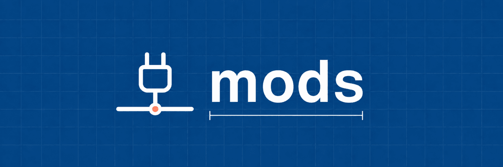

<h1></h1>

Hooks and plugins for Claude Code, Codex, and OpenCode that you install one at a time: commit and infrastructure guards, secret handling, session status panels, and desktop notifications.

Each mod is a plugin built on its host's hooks or plugin API. Mods run with your permissions and are not sandboxed: read a mod before installing it. Each mod lists what leaves your machine (`egress`) in its README and in `mods.json`.

Status: prerelease (v0.x). Installs come from `develop`, the default branch; `main` becomes the stable channel at v1.0.0.

## Install

Set up with an agent:

> Set up https://github.com/iuliandita/mods for the coding agents I use, following its INSTALL.md.

Or install by hand. Run these in a terminal; the plugins also load in Claude Desktop sessions.

    claude plugin marketplace add iuliandita/mods
    claude plugin install <mod>@iuliandita-mods

These calls install from the GitHub marketplace. From a clone, `scripts/mods install <mod>`
registers that clone as the marketplace instead (or `--source <owner/repo>`).

For Codex and OpenCode, see the mod's README and [INSTALL.md](INSTALL.md). OpenCode hook
plugins use `opencode.json`; its terminal UI plugins use the global `cli.json` instead.
After every Codex plugin install or update, trust changed hooks again with `/hooks`.
Codex skips them until trusted, so guards fail open; `scripts/mods doctor` checks their trust.

## Usage

Installed mods run as hooks or panels in the host session. List what a clone offers and what is
installed with `scripts/mods list`, and check the environment with `scripts/mods doctor`. Add
`--json` to either for one machine-readable object. Details are in [INSTALL.md](INSTALL.md).

### Catalog

- `guard-rules`: blocks AI attribution in commits and PRs, direct commits to protected branches, commits under the wrong git identity, and mutating kubectl, helm and terraform calls on protected or unclassified environments.
- `secret-box`: fills named placeholders from Linux Secret Service or macOS Keychain at execution time, with optional directory scopes. The helper scrubs text without a plaintext export command. Tool and directory coverage depend on the host; see [what it does not protect](mods/secret-box/README.md#what-it-does-not-protect). The mod makes no network or model calls; commands it runs may still send values.
- `delegation-board`: a live pane of the session's subagents and teammates: type, model, effort, state, elapsed time and tokens; in Claude Desktop, a compact band above the prompt.
- `statusline`: a two-row status line above the prompt in the terminal and Claude Desktop: model and effort, git state, context against your auto-compact window, 5h and 7d limits with pace, cache, cost and time. In a git repo with a GitHub or GitLab remote it runs `gh` or `glab` for PR and issue counts; `forge=off` turns that off.
- `notify`: a desktop notification when the agent finishes or waits on a permission prompt or other input, titled with the repo and harness, with the branch in the text and an optional sound. It starts `notify-send` on Linux or `osascript` on macOS and makes no network or model calls.

`mods.json` has the full catalog: egress, modes, requirements, and the install command per mod.
`guard-rules`, `secret-box`, `delegation-board` and `statusline` have recorded Claude terminal
checks; `notify` has none yet. The compatibility page lists the tested behavior and versions.
Other Claude surfaces remain unverified.

## Compatibility

`guard-rules`, `secret-box` and `notify` run on Claude Code, Codex and OpenCode. `statusline` and `delegation-board` run on Claude Code and, as terminal UI plugins, on OpenCode.
`secret-box` selects its backend by platform; macOS Keychain access is implemented with mocked
tests and remains unverified on a real host. Windows is unsupported for `secret-box`.
On OpenCode 2.2.1, `secret-box` scrubs outgoing conversation and system content for primary,
compaction, generate and title requests; stored history and output files are not rewritten.
`notify` handles OpenCode 2.2.1 completion events and keeps legacy idle events without duplicate
finish notices per execution; its permission and form events are covered by adapter tests.
On Codex, finish delivery is synchronous with a short cap for `codex exec`; permission
notifications stay in the background.
[What works on which host, and why](docs/COMPATIBILITY.md).

## Private mods

Put your own mods in `local/mods/<name>/` (gitignored) and install them with
`scripts/mods install <name> --local`.

## License

MIT

## Part of the stack

- [agents](https://github.com/iuliandita/agents): global prompts and subagent roles for every harness you use.
- [skills](https://github.com/iuliandita/skills): task skills, installed one at a time. idstack calls them by name.
- mods: hooks for Claude Code, Codex, and OpenCode, installed one at a time.
- [idstack](https://github.com/iuliandita/idstack): infra, DevOps, and SRE playbooks layered on pstack.

Installing one does not install the others.

## Project and support

Made by [iuliandita](https://iuliandita.com). [Other projects](https://iuliandita.com/projects/).

See [installation and recovery](INSTALL.md), [contributing](CONTRIBUTING.md),
[documentation](docs/README.md), and [private security reporting](SECURITY.md).
